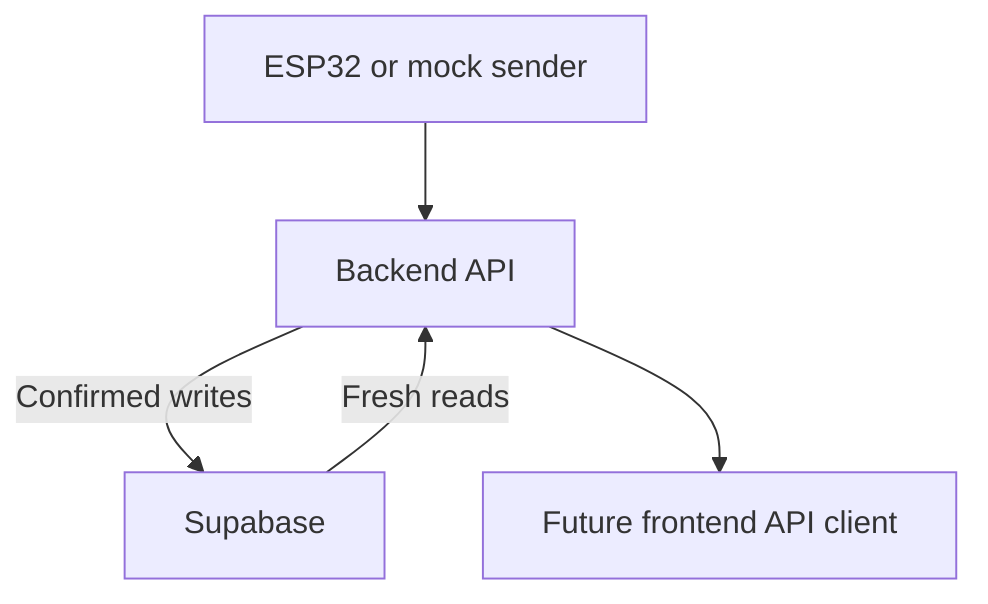

# Drain Monitor

Two US-100 sensors feed an ESP32, which posts JSON frames to the backend. **Supabase is the source of truth for writes and reads.** The frontend is the official Next.js starter page.

## Backend setup

Requires Node.js 24+. No backend dependency install is needed.

1. In the Supabase SQL Editor, apply `supabase/migrations/202610220001_drain_monitor.sql` once. A Data API key cannot create tables.
2. Run `npm run setup` (preserves existing environment files), fill `SUPABASE_URL` and `SUPABASE_SECRET_KEY`, and leave `STORAGE_BACKEND=supabase`.
3. From the repository root:

```sh
npm run check:supabase
npm run verify:supabase
npm start
```

The first command reads all four tables. The second writes a uniquely named synthetic device, calibration, four mock frames and a test, then reads records back through a separate Supabase adapter and through the HTTP API. Verification records remain available for inspection. It runs a temporary local HTTP server and can run before npm start.

Only a PASS establishes a working live connection. The live check in this build environment failed before writes; a successful cloud connection is not claimed. Mocked protocol tests are separate from live database verification.

Startup fails if Supabase is unavailable. Ingestion returns success only after Supabase confirms the write. Every API read queries Supabase with cache disabled, including changes from another writer. There is no automatic SQLite fallback. SQLite is an explicit offline test option and is rejected in production.

After startup, open http://localhost:8000 for the backend testing console, /docs for API instructions and /openapi.json for the contract. In another terminal:

```sh
npm run simulate -- normal
```

Mock data is written to Supabase with source mock. Other scenarios: slow, timeout, shallow. These synthetic fixtures do not establish clog-detection accuracy.



## Default Next.js frontend

The official create-next-app TypeScript/CSS starter replaces the custom dashboard. It has no sensor polling or token fields. The separate backend console remains at port 8000. The corrected typed client is retained in web/lib/api.ts for future integration.

```sh
cd web
npm install next@latest react@latest react-dom@latest
npm install --save-dev typescript @types/node @types/react @types/react-dom
cp .env.example .env.local
npm run dev
```

Open http://localhost:3000. The default layout uses Google fonts, so its first build needs font-download access. Next.js installation, build and browser rendering remain unverified in this build environment.

## Structure and checks

- backend/src: API, sensor analysis and Supabase storage adapter.
- backend/public: separate development console.
- backend/scripts: mock sender and Supabase verification.
- supabase/migrations: schema, indexes and RLS.
- web: default Next.js starter, typed client and optional ingest proxy.
- device and ml: existing hardware/analytics notes.

Run npm run check for backend tests. Tests cover Supabase protocol integration, failed writes and visibility of other writers. See backend/README.md and web/README.md for details. Credentials are excluded from downloads. Public hosting is not deployed.
