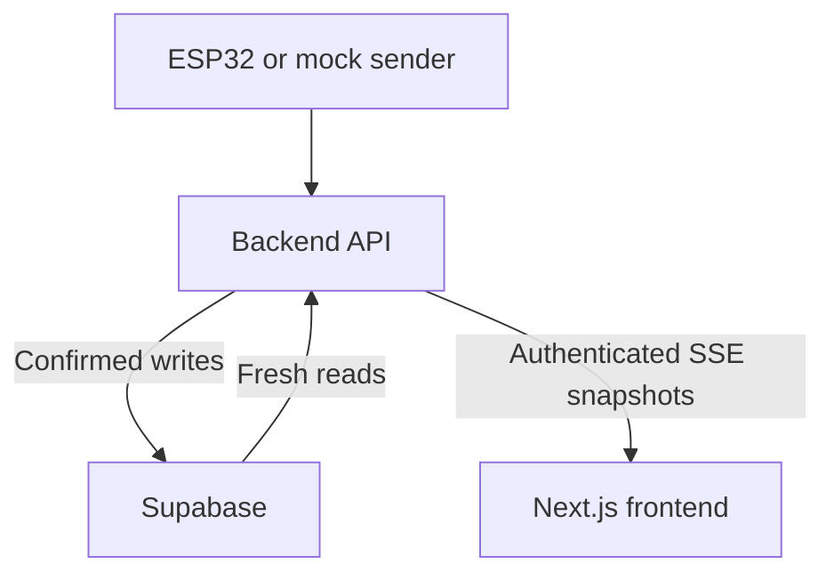

# Drain Monitor

Two US-100 sensors feed an ESP32, which posts JSON frames to the backend. **Supabase is the source of truth for writes and reads.** The Next.js frontend retains its starter styling and displays live readings, calibration state and drainage tests.

## Backend setup

Requires Node.js 24+. No backend dependency install is needed.

1. In the Supabase SQL Editor, apply `supabase/migrations/202610220001_drain_monitor.sql` once. A Data API key cannot create tables.
2. Run `npm run setup` (preserves existing environment files), fill `SUPABASE_URL` and `SUPABASE_SECRET_KEY`, and leave `STORAGE_BACKEND=supabase`.
3. From the repository root:

```sh
npm run check:supabase
npm run verify:supabase
npm start
```

The first command reads all four tables. The second writes a uniquely named synthetic device, calibration, four mock frames and a test, then reads records back through a separate Supabase adapter and through the HTTP API. Verification records remain available for inspection. It runs a temporary local HTTP server and can run before npm start.

The read-only `npm run check:supabase` checks the configured project without creating records. Protocol integration tests run locally; `verify:supabase` is an optional live write/read check and leaves labeled mock records behind.

Startup fails if Supabase is unavailable. Ingestion returns success only after Supabase confirms the write. Every API read queries Supabase with cache disabled, including changes from another writer. There is no automatic SQLite fallback. SQLite is an explicit offline test option and is rejected in production.

After startup, open http://localhost:8000 for the backend testing console, /docs for API instructions and /openapi.json for the contract. In another terminal:

```sh
npm run simulate -- normal
```

Mock data is written to Supabase with source mock. Other scenarios: slow, timeout, shallow. These synthetic fixtures do not establish clog-detection accuracy.



## Live frontend and automatic calibration

The existing page, layout, styles and assets are preserved. The backend-data section receives authenticated SSE snapshots and reconnects automatically. The backend reads Supabase every second while a stream is open, so writes from other processes appear too. This uses the Supabase Data API plus SSE, rather than a browser Supabase subscription; no Realtime publication or schema migration is required. Browser recovery reads run every 15 seconds. Supabase secrets remain exclusively on the backend; a configured backend API token is entered in the existing form and kept in memory.

```sh
npm --prefix web ci
npm --prefix web run dev
```

Open http://localhost:3000 with the backend running. Existing `backend/.env` and `web/.env.local` files should be retained. Use `npm run setup` only to create missing environment files. The existing Google fonts require network access for the production build.

For a device without a calibration, **start with the fixture empty**. Automatic calibration assumes startup is empty: still water and an empty fixture cannot be distinguished from distance stability alone. Five valid consecutive two-sensor frames must span at least two seconds, with no gap above five seconds, one boot/clock/source and no more than 4 mm distance variation per sensor. The next consecutive frame triggers persistence of the median empty distances; subsequent frames use that immutable baseline. Earlier uncalibrated records remain unchanged. Timeouts, missing sequences, repeated timestamps and noisy samples prevent calibration until a valid window arrives.

Automatic baselines are separate for mock and hardware data, survive server restarts, and never replace an existing applicable baseline. Existing manual calibrations remain supported and apply to either source. Set `AUTO_CALIBRATE=false` in the backend environment to require manual calibration. Repositioning sensors requires a new manual calibration.

## Local validation

```sh
npm run check
npm --prefix web run typecheck
npm --prefix web run build
npm run check:supabase
```

The test suite covers persisted calibration, source isolation, invalid/noisy samples, existing manual baselines, authenticated streaming, external database writes and storage failures. The final command is read-only against the configured live project.

## Structure and checks

- backend/src: API, sensor analysis and Supabase storage adapter.
- backend/public: separate development console.
- backend/scripts: mock sender and Supabase verification.
- supabase/migrations: schema, indexes and RLS.
- web: styled Next.js starter with live backend data, typed client and optional ingest proxy.
- device and ml: existing hardware/analytics notes.

Run npm run check for backend tests. Tests cover Supabase protocol integration, failed writes and visibility of other writers. See backend/README.md and web/README.md for details. Credentials are excluded from downloads. Public hosting is not deployed.

## Graph and forecasting proof of concept

Open `/insights` on the frontend for an interactive synthetic preview, or choose **Live Supabase data** for persisted sensor readings. The home page redirects to `/insights`. The preview never writes to the database.

- Separate A/B distance traces and empty reference lines.
- Local water-depth traces with wet/dry thresholds and an experimental time-to-dry extrapolation.
- Completed drainage durations for the same fixture, source and calibration.
- Scrubbable normal, slow, missing-echo and rising-water scenarios, plus a stale-data toggle.
- Expandable plotted values and quality labels for design and hardware inspection.

The live view offers confirmed-empty calibration (at least 20 stable paired samples over eight seconds, a 30-second timeout, and per-sensor median references and observed noise) and start/finish controls for controlled drainage tests. New guided calibrations include the selected source; legacy manual calibration requests without a source remain compatible. Automatic startup calibration remains available separately as documented above.

The forecast fits each sensor’s most recent eight valid consecutive readings to a local straight line. It requires at least six samples over two seconds, a falling trend with R² ≥ 0.85 and a fall rate above 0.2 mm/s. It uses the slower sensor’s crossing of the dry threshold, not a claim of zero water, and caps its horizon at 120 seconds. Stale readings, invalid echoes, gaps, clock/boot/calibration changes, flat or rising water suppress the estimate. Dashed segments are extrapolations, not observations or validated confidence intervals. No maintenance or blockage date is predicted.

Basin dimensions affect volume-versus-level relationships. Empty calibration learns local sensor references, not basin geometry. Repeatable starting water marks and known-good drainage trials can characterize an individual fixture without manual dimension entry. Volume or flow-rate estimation requires an independently measured volume-versus-level curve or additional sensing. Physical US-100 testing and held-out drainage trials are still required before business use.

## Practice retrieving graph data from Supabase

```sh
npm run seed:practice
npm start
# In another terminal:
npm --prefix web run dev
```

Open `/insights`. It defaults to **Supabase practice data**, which reads the dedicated `graph-practice-sink-v1` mock device from the real database. The seed writes 280 readings, one mock-only calibration and six completed tests with computed durations of 39, 40, 38, 42, 48 and 55 seconds. Records remain in Supabase for inspection. The seed is repeatable, resumes partial runs, and does not overwrite unrelated devices or hardware data.

Choose a saved test and scrub Replay to reconstruct its countdown from the stored frames. This is explicitly labeled historical mock replay; archived data is not presented as a fresh hardware feed. **Read Supabase again** performs new uncached API reads. Missing data or connection errors are shown instead of falling back to generated fixtures. **Local synthetic preview** remains a separate option.

Read path: browser → same-origin Next.js GET gateway → backend API → Supabase. The gateway allows only device/history/session reads, forwards a caller-supplied backend token when needed, and does not contain or inject Supabase credentials. The backend URL remains configured by the existing server-side `BACKEND_URL`. No environment-file changes or schema migration are required.
