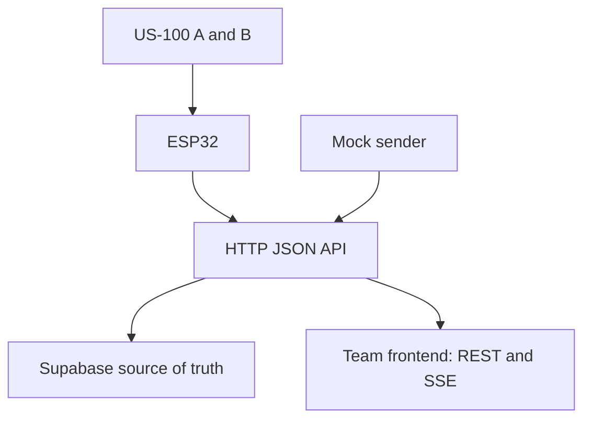

# Retrofit bathtub drainage monitor

Backend foundation for the Texas Convergent IoT build: **two US-100 ultrasonic sensors → ESP32 → HTTP JSON → backend → database + frontend**. Mock and hardware producers use the same contract. This repository includes a deliberately plain integration console; the design team can replace it without changing the API.

## Run with Supabase — no hardware or backend package install needed

Requires **Node.js 24 or newer** (uses built-in `node:sqlite`). There are no third-party runtime or test dependencies.

```sh
npm --prefix .. run setup
# Fill SUPABASE_URL and SUPABASE_SECRET_KEY, and apply the SQL migration first.
npm run check:supabase
npm run verify:supabase
npm start
```

Open **http://localhost:8000** for the integration console, **http://localhost:8000/docs** for the API guide, and **http://localhost:8000/openapi.json** for the OpenAPI 3.1 contract. Supabase is the default source of truth. Startup checks all four tables and fails if access is unavailable; there is no automatic local fallback. SQLite is only an explicit offline test option (`STORAGE_BACKEND=sqlite`), and is rejected in production. Node may print a warning that its SQLite API is experimental; that does not indicate a failed startup.

In a second terminal:

```sh
npm run simulate -- normal
npm run simulate -- slow
npm run simulate -- timeout
npm run simulate -- shallow
```

Run scenarios one at a time. Select `demo-tub` and **Mock** in the console. Normal is about 9 seconds, slow about 25 seconds, timeout deliberately loses sensor B near the end, and shallow never provides enough water to start a valid filled-tub drainage measurement. These are synthetic engineering fixtures, not measured tub performance. If a sender is interrupted, use **Refresh tests → Finish test** before starting another test for that device/source.



## Implemented

- Device registration and bounded reading history, with strict JSON validation and structured errors.
- Two independent sensor readings per frame, in millimeters or raw echo microseconds. Missing echoes are explicit unknown values.
- Idempotent retries with `event_id`; `(device_id, boot_id, sequence)` also prevents duplicated measurements.
- Immutable per-sensor empty-tub calibrations. History retains its original calibration. A test pins its starting calibration.
- Explicit drainage test start/finish and durable results. Completion requires both sensors to become wet, then both to become stably dry. Large gaps produce inconclusive results.
- Mock/hardware source separation, stale-device indication, REST access and live Server-Sent Events.
- Supabase-backed persistence, fresh database reads, a SQL migration with RLS, a real write/read verification command, deployment container, CI and integration tests. SQLite exists only for explicit offline tests.

## Sensor contract

Register a stable physical device ID before sending measurements. Sensor `a` is near the drain; `b` is farther along the tub. Each US-100 module contains two transducers; the system still has **two measurement locations**, not four sensors.

```sh
curl -X POST http://localhost:8000/api/v1/devices \
  -H 'Content-Type: application/json' \
  -d '{"device_id":"tub-01","name":"Prototype bathtub"}'
```

Send a frame about once per second; the ESP32 should trigger A and B **sequentially**, allowing an echo timeout and a quiet interval between them to limit acoustic interference. Begin hardware experiments with at least 60ms between triggers, then validate that spacing on the actual tub. The backend cannot correct acoustic interference in firmware.

```json
{
  "event_id": "10000000-0000-4000-8000-000000000001",
  "device_id": "tub-01",
  "boot_id": "20000000-0000-4000-8000-000000000001",
  "sequence": 0,
  "captured_at": null,
  "source": "hardware",
  "temperature_c": 20,
  "readings": [
    { "sensor_id": "a", "status": "ok", "distance_mm": 300 },
    { "sensor_id": "b", "status": "timeout" }
  ]
}
```

POST that JSON to `/api/v1/readings`. A new event returns 201. Retrying the same event and payload returns 200 with `duplicate: true`. Reusing an event ID with changed contents, or using a new event ID for the same device/boot/sequence, returns 409. Keep the event ID and payload unchanged through retries, generate a fresh boot UUID on restart, and increment sequence for each new frame. A retry may have an old timestamp; do not regenerate its timestamp.

For each `ok` reading, send exactly one of:

- `distance_mm`: distance already calculated by firmware or returned in US-100 UART mode. Range 20–4500mm.
- `echo_us`: round-trip pulse duration. The backend calculates `distance_mm = echo_us × (331.3 + 0.606 × temperature_c) / 2000`; 20°C is assumed if temperature is absent. This approximation and sensor accuracy are not the same thing. Do not apply it to UART distance values.

Use `status: "timeout"` or `"out_of_range"` with omitted/null measurement fields for failed readings. Do not use zero to represent no echo. Send both sensor entries even if one fails.

`captured_at` must be timezone-aware ISO 8601 after ESP32 clock synchronization. Before synchronization, omit it or send null: the server timestamps receipt and reports `time_basis: "server_received"`. That time includes network delays and is unsuitable for precise timing if buffered samples are uploaded together. Mixing timing bases within an experiment makes its timing result inconclusive. Raw echo duration is the acoustic round trip; **drainage time is elapsed time across multiple frames**, not echo duration.

## Calibration and drainage tests

1. Mount both modules so they face down and their mounts cannot move during a test. Keep them dry. US-100 boards are not waterproof.
2. With an empty tub, collect stable valid readings for each sensor independently. Reject outliers and use the median as its `empty_distance_mm`. The API stores the chosen baselines; it does not automatically estimate them from a single frame.
3. POST `/api/v1/devices/tub-01/calibrations`:

```json
{"empty_distance_mm":{"a":400,"b":420},"wet_threshold_mm":20,"dry_threshold_mm":8,"stable_samples":3,"max_gap_ms":5000}
```

4. Fill the tub so water is visible under **both** sensors. POST `/api/v1/devices/tub-01/sessions` with `{"source":"hardware","name":"Drain test 1"}` immediately before opening the drain.
5. Continue sending frames while it drains. GET `/api/v1/sessions/{id}` for analysis; POST `/api/v1/sessions/{id}/finish` to close and store the result.

Local depth is `max(0, empty_distance_mm - measured_distance_mm)`. An echo more than 20mm beyond the known floor is marked invalid rather than dry. These thresholds are **initial configurable test settings**, not validated product tolerances. Different floor heights mean local depths may differ even for a flat water surface; the backend does not average the two readings or assume disagreement means sensor failure. Width and tub volume are unnecessary for elapsed drainage time. Liters/minute would require separate geometry/volume calibration and is not implemented.

Drainage time runs from the first frame where **both sensors** are at or above the wet threshold to the first of the required consecutive frames where **both sensors** are below the dry threshold. A failed frame resets the consecutive dry counter. A gap beyond `max_gap_ms` between valid frames after wet detection invalidates the timing result. A sensor that was never wet prevents a completed measurement. This initial method targets filled-bath tests; it does not solve shallow shower runoff at the far end.

Completed reports are frozen; late packets do not rewrite them. Active reports are recomputed from stored frames, including out-of-order arrivals. Sessions longer than 5000 frames return inconclusive; use bounded experiments. Repeated timestamps do not count as independent stable samples.

**Not implemented or established:** automatic plug-release detection, validated clog classification, corrosion sensing, direct flow measurement, automatic healthy/slow thresholds, predictive maintenance, customer accounts/tenant separation, billing, piezo commands or deployed ESP32 firmware. The API is the handoff contract for the firmware and design teams. Collect repeatable clean/partially restricted drainage experiments before claiming diagnostic accuracy.

## Connect the design team's frontend or an ESP32

The server binds to `0.0.0.0` by default. On the same Wi-Fi, use `http://<backend-computer-LAN-IP>:8000`; **localhost on an ESP32 points to the ESP32, not your laptop**. Allow inbound port 8000 through the host firewall. University guest Wi-Fi may isolate devices; use a permitted shared network/hotspot if necessary.

- Frontend: use the backend base URL, never the Supabase secret. Set `CORS_ORIGINS` to its exact development origin(s), comma-separated. Default: localhost/127.0.0.1 on ports 3000 and 5173. A development-only `*` is supported.
- ESP32: POST frames with `Content-Type: application/json`. CORS is a browser rule and does not restrict the ESP32.
- With `API_KEY` configured, both clients send `Authorization: Bearer <API_KEY>`. This is a shared team prototype token, not user authentication. The test page holds it only in memory.
- SSE: GET `/api/v1/devices/{id}/stream` using streaming `fetch` when auth is enabled; native browser EventSource cannot add that Authorization header. The endpoint sends `connected` and `reading` events with 15-second comment heartbeats. It sends both mock and hardware events; filter on `source` as the console does.
- SSE is a live convenience with no replay. On reconnect, recover state/history using REST, then reconnect. There is a small REST/SSE subscription race: refresh REST again after subscribing when gap-free display matters.
- History supports `?source=hardware&limit=100&since=<ISO-timestamp>` (newest first, limit 1–500). It is a bounded integration history, not an exhaustive export endpoint. GET devices lists at most 100, tests at most 30.

## Supabase setup

The uploaded project information supplies a project URL, publishable key and server secret. A server secret permits Data API access; it is **not** a database password or Management API token, so it cannot apply SQL migrations.

1. In the project's Supabase SQL Editor, run `../supabase/migrations/202610220001_drain_monitor.sql` (relative to this backend directory) once. It creates only `dm_*` tables, enables RLS and denies direct anonymous/authenticated access. The controlled backend uses the secret key. No public database policies are needed.
2. Set `SUPABASE_URL` and `SUPABASE_SECRET_KEY` in the **server's** `.env`. Never use a `VITE_`/`NEXT_PUBLIC_` prefix for the secret, send it to ESP32 firmware, or commit the uploaded credentials.
3. Leave `STORAGE_BACKEND=supabase` (the default). Run `npm run check:supabase` to check all four tables without writing. Run `npm run verify:supabase` to insert a uniquely named synthetic device, calibration, four mock frames and a completed test, then fetch the records through a separate Supabase adapter and through the API. The verification records are retained and clearly labeled mock. Only a PASS verifies live writes and reads.
4. Start the backend and register real devices/calibrations in Supabase. Existing SQLite records are not automatically migrated. Every API read queries Supabase with cache disabled; successful ingestion is acknowledged only after Supabase returns the persisted row. Failed database writes return 503. No local fallback is used.

The publishable key and JWKS URL are not needed for this shared-token prototype. They become relevant when adding Supabase Auth. This implementation has adapter contract tests; live Supabase connectivity and the migration must still be verified in the team's environment. The live check in this build environment failed before writes; a successful live connection is not claimed. Run the verification command from your own machine after applying the migration.

## Deploy for team access

```sh
node -e "console.log(require('node:crypto').randomBytes(32).toString('hex'))"
```

Use the generated value as `API_KEY`. Set `NODE_ENV=production`, explicit `CORS_ORIGINS`, and Supabase storage after migration. Production startup rejects missing/short tokens and wildcard browser origins. Host the service on a Node 24 or Docker-capable host with HTTPS. The container respects a platform-provided `PORT`; `/health` is liveness, `/ready` checks database access. Do not put the Supabase secret in an image layer: provide deployment environment variables.

```sh
# Run these commands from the repository root, one directory above backend/.
docker build -t drain-monitor .
docker run --rm -p 8000:8000 --env-file backend/.env drain-monitor
```

Production requires Supabase, so database records survive API process/container replacement. SQLite is limited to explicit offline development tests. SSE connections are per server process. Run one API instance for this prototype; multiple instances need a shared event bus or database-backed realtime for cross-instance streaming. Production token authentication covers all data with a single role; add per-device credentials and user/tenant authorization before a customer rollout. Rate limiting should be enforced by your hosting proxy before opening ingestion publicly.

## Validation

```sh
npm run check
```

Tests exercise HTTP ingestion, retries including concurrent retries, duplicate sequence conflicts, validation, missing echoes, echo conversion, timestamp fallback, source separation, API authentication, CORS, body limits, persistent storage, test timing, inconclusive results, SSE delivery, immutable calibration history, production configuration, static-page serving and Supabase adapter behavior. All four simulator scenarios were also run end to end against the API. The console was syntax checked and its files were tested over HTTP; a browser interaction test could not run because a browser executable was unavailable in the build environment. Hardware measurements and live Supabase migration are separate outstanding integration checks.

Hardware reference: [current team parts list](https://docs.google.com/document/d/1XIAfMKkZk-sJJYISNm_GJHvuB-Wmmrhnhrqttcz_yaE/edit?tab=t.0), reviewed October 22, 2026. It lists two US-100 modules, a HiLetgo ESP-WROOM-32, a 400-point breadboard, M/M and F/M wires, 220Ω resistors, Micro-USB cable and optional PS1240 piezo. References: [US-100 behavior](https://www.adafruit.com/product/4019), [Supabase server keys](https://supabase.com/docs/guides/getting-started/api-keys), [Supabase Data API](https://supabase.com/docs/guides/api/creating-routes).
